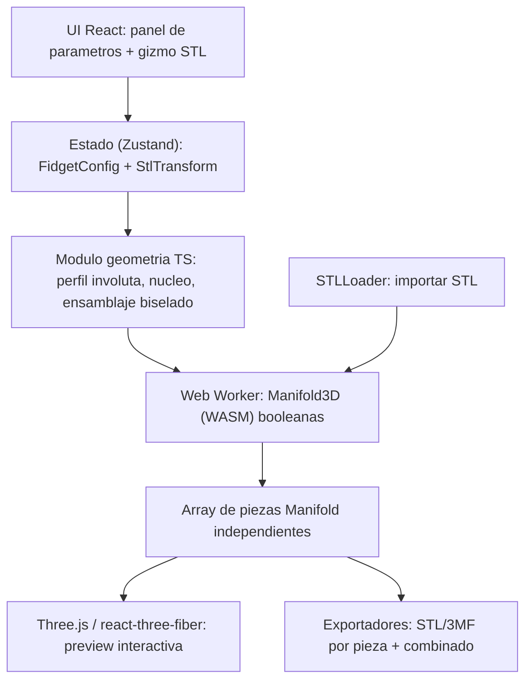

# Documento tecnico: generador web de esferas de engranajes con recorte por STL

Decisiones confirmadas: ejecucion **100% en el navegador** (sin servidor) y topologias de
engranajes mediante **familias parametricas validadas** (basadas en poliedros), no N arbitrario.

Este documento acompana a la implementacion de referencia incluida en este repositorio
(`index.html`, `src/`). Define arquitectura, tecnologias, el analisis del repositorio
`astaff/fidget`, los algoritmos, la estrategia de STL/booleanas, la conservacion de piezas
individuales, las dificultades y el plan por etapas.

---

## 1. Arquitectura general propuesta

Aplicacion web estatica (SPA) donde toda la geometria se calcula en el cliente. No hay backend:
el STL del usuario nunca sale del navegador (privacidad) y el despliegue es un hosting estatico.

Capas:

- Presentacion: React + Vite + TypeScript; `react-three-fiber` + `drei` para el viewport;
  `TransformControls` para el gizmo del STL.
- Estado: `zustand` con `FidgetConfig` (parametros mecanicos) y `StlTransform` (traslacion,
  rotacion, escala por eje, opacidad, visibilidad).
- Geometria parametrica (TS puro): perfil involuta, nucleo poliedrico, colocacion y orientacion
  de engranajes biselados. Produce datos parametricos (perfiles + transformaciones) que el worker
  convierte en solidos.
- Nucleo CSG: `manifold-3d` (WASM) ejecutado en un Web Worker para no bloquear la UI; construye los
  solidos (extrusion, revolucion, hull) y hace las intersecciones/diferencias reales.
- Export: STL binario y 3MF (multi-objeto, preserva piezas y color); glTF opcional.

Mapa de modulos de la implementacion:

- `src/geometry/involute.ts`: perfil de diente involuta parametrico.
- `src/geometry/polyhedra.ts`: familias de poliedros, normales de cara y grafo de adyacencia.
- `src/geometry/meshing.ts`: validacion del grafo de engrane (paridad de ciclos, modulo/dientes).
- `src/geometry/assembly.ts`: plan de ensamblaje (que pieza, con que transformacion).
- `src/worker/manifold.worker.ts`: construccion de solidos y booleanas con Manifold3D.
- `src/worker/manifoldClient.ts`: puente tipado main <-> worker.
- `src/io/stl.ts`, `src/io/threemf.ts`: importacion/exportacion.
- `src/components/*`: viewport, panel de parametros, controles de STL, avisos.

## 2. Tecnologias recomendadas (comparativa)

| Tecnologia | Rol | Ventajas | Limitaciones | Decision |
| --- | --- | --- | --- | --- |
| Three.js (r3f) | Render 3D | Estandar, ecosistema (drei, TransformControls, mesh-bvh) | CSG propio debil | Si (solo render) |
| Manifold3D (WASM) | Motor CSG | Rapido, robusto, salida manifold/watertight, extrude/revolve/hull | Malla triangular, no B-rep | Si (motor) |
| OpenCascade (opencascade.js) | B-rep | Exacto, STEP, fillets | WASM pesado (decenas de MB), API compleja, lento | Futuro (STEP) |
| build123d | CAD Python | Potente (sobre OCCT) | No corre en navegador | Descartado |
| trimesh | Mallas Python | Base de astaff/fidget | No navegador | Referencia |
| three-mesh-bvh | Colisiones | Rapido raycast/intersect | Solo malla | Si (interferencias) |

Conclusion: stack v1 = TypeScript + Vite + React + three.js (r3f) + Manifold3D (WASM, en worker).
Manifold3D se elige ademas porque es el mismo backend booleano que usa `trimesh` en
`astaff/fidget`, de modo que reutilizamos su garantia de robustez en el navegador. OCCT queda como
extension opcional para exportar STEP.

## 3. Analisis del repositorio astaff/fidget

Estructura: todo el motor esta en `src/fidget/ops.py` (~250 lineas) y `src/fidget/types.py`; el
resto es notebook de ejemplo y assets. Dependencias: `trimesh`, `manifold3d`, `shapely`, `scipy`,
`networkx`, `pydantic`, `svg-path`. Licencia Apache-2.0.

Como funciona el mecanismo (no es decorativo):

- `build_core(diameter)`: nucleo = interseccion de un octaedro y un cubo; extrae las 8 caras del
  octaedro (`Face(normal, origin)`) como puntos de montaje. Normales en direcciones (+-1,+-1,+-1).
- `build_gear(GearConfig)`: carga un perfil 2D, lo extruye a `height` y aplica un escalado lineal en
  Z controlado por `angle` -> engranaje conico/biselado (diametro superior != inferior).
- `build_pin` / `add_hole(s)`: pines de retencion (perfil revolucionado) y agujeros alineados al
  normal de cada cara.
- `align_gear` / `rotate_gear`: orientan cada engranaje al normal de su cara y fijan la fase angular
  (`gear_rotations`) para que engranen.
- `apply_shape(shape, gears)`: `intersection(gear, shape)` por engranaje. `shape` puede ser cubo,
  esfera (icosphere) o STL (`ShapeType.CUSTOM`) con offset/rotacion/escala por eje. Esto ES la
  segunda funcionalidad pedida.

Por que engrana (base mecanica): 8 engranajes biselados identicos con eje en los normales del
octaedro; el angulo entre normales adyacentes (arccos(1/3) ~ 70.53 grados) fija el angulo de ejes,
y conos de paso de semiangulo ~35.26 grados con mismo modulo y numero de dientes dan accion
conjugada. Por eso la topologia es fija (octaedro): garantiza engrane.

Que se reutiliza (como referencia algoritmica, portado a TS):

- Nucleo poliedrico con caras como ejes de montaje.
- Estrategia de pines/agujeros y holguras.
- `apply_shape` = interseccion por pieza (traslada 1:1 a Manifold3D en navegador).
- La parametrizacion (`FidgetConfig`, `GearConfig`, `PinConfig`, `ShapeConfig`).

Que cambia/se anade:

- Reescritura Python -> TypeScript (no hay runtime Python en navegador; Pyodide seria pesado).
- Engranaje por matematica de involuta parametrica en vez de un SVG precalculado.
- Varias familias/topologias (tetraedro, octaedro/cubo) en vez de solo octaedro.
- UI interactiva, gizmo de STL, transparencia/visibilidad, deteccion de interferencias, regeneracion.
- Export por pieza desde el navegador.

## 4. Algoritmos para generar la esfera de engranajes

1. Perfil de diente (involuta, 2D) -- `src/geometry/involute.ts`:
   - Datos: modulo m, dientes z, angulo de presion alpha (20 grados por defecto), holgura.
   - Diametro de paso d = m*z; base db = d*cos(alpha); addendum = m; dedendum = 1.25*m.
   - Curva involuta por puntos, reflejada para un diente, repetida z veces (2*pi/z), cerrada con
     circunferencias de addendum/dedendum.
2. Cuerpo 3D del engranaje (en worker con Manifold):
   - Recto: extrusion del poligono a `thickness`.
   - Biselado (necesario para la esfera): extrusion con `scaleTop = topDiameter/bottomDiameter`
     (equivalente navegador del escalado-en-Z de astaff; aproximacion de Tredgold del cono de paso).
     La involuta esferica exacta es compleja; Tredgold es el estandar de ingenieria y se documenta
     como aproximacion.
   - Agujero del eje (diametro de eje + holgura).
3. Nucleo central -- `src/geometry/polyhedra.ts` + worker:
   - Octaedro intersecado con cubo (como astaff), parametrizado por el diametro; caras = ejes.
   - Agujeros de pin por cara.
4. Ensamblaje -- `src/geometry/assembly.ts`:
   - Por cara: alinear [0,0,1] -> normal, trasladar a (origen + normal*offset), fijar fase angular.
   - Pines de retencion por cara.
5. Validacion de engrane: mismo modulo y dientes entre vecinos; angulo de ejes = angulo entre
   normales adyacentes; semiangulo de cono = angulo_ejes/2; distancia entre centros y juego de punta.

## 5. Estrategia de distribucion sobre geometria esferica

- Ejes de los engranajes = normales de las caras de un poliedro (simetria y angulos de eje
  repetibles).
- Familias validadas y angulo entre normales adyacentes:
  - Octaedro/cubo (astaff): arccos(1/3) ~ 70.53 grados.
  - Tetraedro: precomputado por pares de caras adyacentes.
- Grafo de engrane: nodos = engranajes, aristas = pares que engranan (caras adyacentes).
  RESTRICCION CRITICA: en un lazo cerrado, los ciclos de longitud impar bloquean el mecanismo (cada
  engrane invierte el sentido). Se verifica que el grafo sea 2-coloreable (bipartito); si hay un
  ciclo impar el mecanismo se bloquea y la UI lo avisa.
- "Numero de engranajes" y "distribucion" se eligen entre configuraciones validas (no cualquier
  entero), consistente con la decision tomada.

## 6. Estrategia de importacion de STL y operaciones booleanas

- Importacion: `STLLoader` -> geometria -> malla Manifold (vertices/indices). Validacion de
  manifold/watertight; si no es cerrado, reparacion basica (merge de vertices) y aviso; fallback por
  bounding si la reparacion falla.
- Transformaciones del STL (solo recorte, sin generar mecanismo): traslacion XYZ, rotacion XYZ,
  escala proporcional y por eje; opacidad y visibilidad. Se aplican como matriz antes de la booleana.
- Operacion: GEOMETRIA FINAL = MECANISMO INTERSECT STL_transformado. Se ejecuta
  `intersection(pieza, STL)` por pieza en el worker (equivalente navegador de `apply_shape`). Todo lo
  que quede fuera del STL se elimina.
- El STL no modifica parametros mecanicos: es exclusivamente herramienta de recorte.

## 7. Estrategia para conservar piezas individuales

- Nunca unir las piezas en un solo solido. Se mantiene un mapa `id -> Manifold` con cada engranaje,
  el nucleo y cada pin por separado.
- La booleana con el STL se aplica pieza a pieza; el resultado sigue siendo una lista de piezas.
- Export individual: STL por pieza; 3MF multi-objeto que agrupa todas las piezas preservando
  identidad; layout en rejilla para impresion (equivalente a `arrange_meshes`).
- Limitacion: STL no guarda color ni ensamblaje; para un unico archivo con piezas separadas usar 3MF.

## 8. Principales dificultades mecanicas y geometricas

- Engrane valido en lazo cerrado: los ciclos impares bloquean el giro; restringe las topologias
  (dificultad principal, mitigada con familias validadas y verificacion de bipartido).
- Involuta esferica exacta vs aproximacion de Tredgold para biselados; se asume Tredgold y se
  documenta la limitacion de precision.
- Robustez de STL del usuario: mallas no manifold, auto-intersecciones o invertidas rompen la
  booleana; requiere validacion/reparacion y aviso.
- Deteccion de interferencias: colisiones de punta, solape de cuerpos, choque con pines; se usa
  `three-mesh-bvh` para chequeo de colision y verificaciones analiticas de distancia entre
  centros/juego.
- Coste de booleanas con mallas densas: ejecutar en worker, cachear, simplificar perfiles.
- Holguras reales de impresion 3D para que las piezas giren tras imprimir.
- Sin B-rep en v1: no hay STEP ni fillets exactos (limitacion aceptada; OCCT.js futuro).

## 9. Plan de desarrollo por etapas

1. Scaffold Vite+React+TS, viewport, panel de parametros (zustand), Manifold3D en worker.
2. Generador de perfil involuta y engranaje recto.
3. Nucleo poliedrico + engranajes biselados + ensamblaje de la esfera.
4. Validacion de engrane (grafo/paridad) y deteccion de interferencias.
5. Importar STL + gizmo de transformacion + opacidad/visibilidad.
6. Interseccion pieza-a-pieza MECANISMO INTERSECT STL en worker.
7. Export por pieza (STL) y multi-objeto (3MF) + regeneracion en vivo.
8. Pulido: presets, rendimiento, avisos de interferencia, documentacion.

---

## Justificaciones y limitaciones (resumen)

- Browser-only + Manifold3D por privacidad del STL, cero coste de servidor y booleanas robustas
  exportables a impresion.
- No se inventan soluciones mecanicas: la validez de engrane se apoya en topologias de poliedros con
  angulos de eje conocidos y en la verificacion del grafo de engrane (paridad de ciclos).
- Limitaciones explicitas: engrane biselado por aproximacion de Tredgold; sin STEP/B-rep en v1;
  dependencia de STL manifold; "numero de engranajes" restringido a configuraciones validas.

---

## 10. Motor mecanico: implementacion verificable (actualizacion)

Esta seccion documenta el motor mecanico ya implementado y verificado por pruebas.

### 10.1 Tipo de engranaje segun la orientacion de los ejes

Todos los ejes de los engranajes son concurrentes en el centro de la esfera (apuntan a los normales
de las caras del poliedro). Para ejes que se cortan, el tipo mecanicamente correcto NO es el
engranaje cilindrico (recto/helicoidal, para ejes paralelos) sino el **engranaje conico angular
(bevel)**: sus conos de paso comparten el apice en el punto de interseccion de los ejes (el centro
de la esfera). Con engranajes identicos, el semiangulo de cono = angulo_de_ejes / 2 garantiza accion
conjugada. En el octaedro el angulo de ejes es arccos(1/3) = 70.53 grados -> semiangulo 35.26 grados.
Se genera por la aproximacion de Tredgold (perfil involuta 2D extruido con conicidad `scaleTop`), el
equivalente en Manifold del escalado-en-Z de `astaff/fidget` (`build_gear` en `ops.py`).

### 10.2 Solver de fase de engrane ([`src/geometry/kinematics.ts`](../src/geometry/kinematics.ts))

Para que los dientes encajen (diente contra hueco) en el punto de contacto de cada par, no basta un
desfase global de medio diente. El solver:

1. 2-colorea el grafo de engrane (bipartito) -> sentido de giro `spin_i = +/-1`.
2. Para cada par (i,j) calcula la linea de contacto `b_ij = normalize(n_i + n_j)` y su azimut en el
   marco local de cada engranaje.
3. Resuelve la fase de montaje `beta_i` para que cada engranaje presente diente (color 0) o hueco
   (color 1) en todas sus lineas de contacto, y verifica congruencia y cierre de ciclos.

Restriccion descubierta y verificada: en el octaedro cada engranaje tiene 3 contactos separados
120 grados, por lo que la fase solo cierra si el paso angular divide a 120 grados, es decir, si
**z es multiplo de 3**. El solver marca como no funcional cualquier z que no lo cumpla (residuo > 0),
y tambien las topologias no bipartitas (tetraedro: se bloquea).

### 10.3 Cinematica y simulacion

Razon de transmision 1:1 (engranajes identicos), sentidos alternos por el 2-coloreo. El angulo de
cada engranaje es `gearAngle(i, theta) = beta_i + spin_i * theta`. La simulacion de reproduccion
([`src/components/Viewport.tsx`](../src/components/Viewport.tsx)) gira cada engranaje alrededor de su
eje (que pasa por el origen) en funcion del angulo maestro `theta`, permitiendo verificar el engrane
visualmente.

### 10.4 Holguras FDM

Holguras separadas y parametrizables: `backlash` (reduce el espesor del diente por flanco),
`radialClearance` (juego de fondo, afecta addendum/dedendum) y `axialClearance` (montaje axial / eje).
El agujero del eje se amplia con `pinClearance + axialClearance/2`.

### 10.5 Pines de retencion

Pin escalonado generado por `Manifold.revolve` de un perfil [radio, axial] con cabeza de retencion,
reutilizando el concepto del pin de `astaff/fidget` (`build_pin`), parametrizado al diametro de eje.

### 10.6 Piezas independientes y exportacion

El constructor compartido [`src/geometry/build.ts`](../src/geometry/build.ts) (usado por el worker y
por las pruebas headless) mantiene cada pieza como un `Manifold` separado: 1 nucleo + N engranajes +
N pines. Cada una se exporta a STL individualmente (`exportPartStl`).

### 10.7 Deteccion de interferencias

- Estatica: engranajes no adyacentes nunca deben tocarse (three-mesh-bvh).
- Dinamica ([`sweepInterferences`](../src/geometry/interference.ts)): gira el mecanismo por un periodo
  de diente y comprueba en varias muestras que no hay colisiones indebidas durante el giro.

### 10.8 Pruebas ([`tests/`](../tests)) y validacion

- `npm test` (vitest): perfil involuta (radio de paso, base, dientes); topologia octaedrica
  (8 engranajes, 12 pares, 70.53 grados); solver valido con z multiplo de 3 e invalido en caso
  contrario; tetraedro no bipartito; piezas watertight (`status NoError`, volumen > 0); engrane sin
  atasco (solape booleano minimo en adyacentes, nulo en no adyacentes) a lo largo de un barrido.
- `npm run validate` (headless): construye el mecanismo completo y reporta validez cinematica,
  geometria, numero de piezas y una booleana de recorte de ejemplo.
